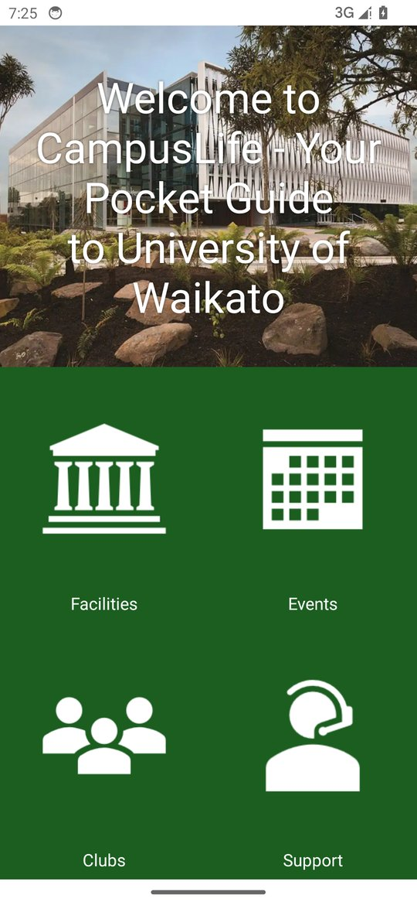
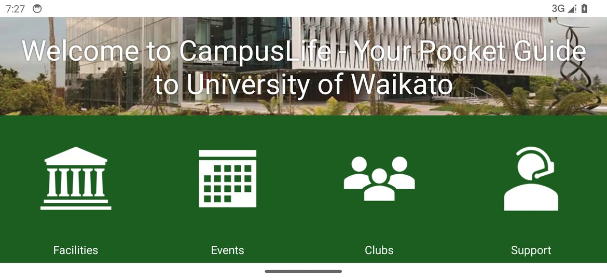
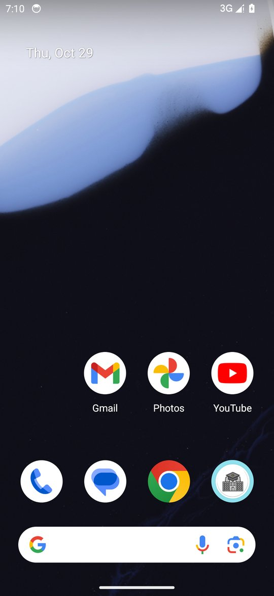
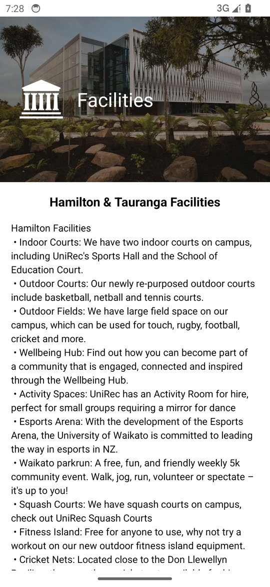
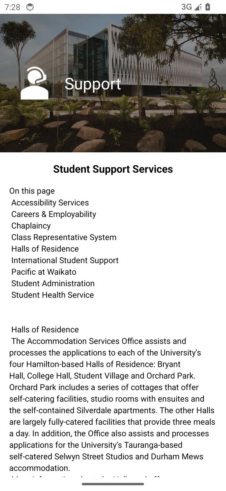
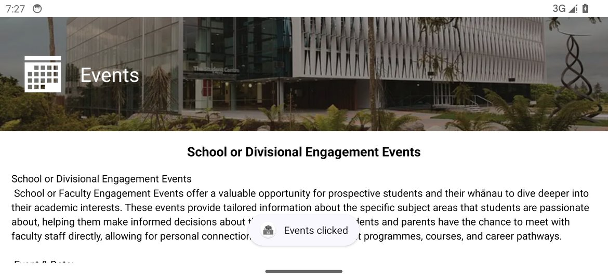

# CampusLife — COMPX202 / Y05853 Assignment One

| | |
|---|---|
| **Author** | 郑剑彬 (Zheng Jianbin) |
| **Student ID** | 20243007052 |
| **Unit** | COMPX202 / Y05853 — Introduction to Android |
| **App name** | CampusLife |
| **Repository name (to push to)** | `20243007052-AssignmentOne` |

## 1. About the app

CampusLife is a small "pocket guide" for University of Waikato students. The home
screen shows a campus photo with a welcome banner and four topic buttons
(Facilities, Events, Clubs, Support). Tapping a button shows a confirmation
Toast and opens a detail screen that is filled with the matching title, body
text and icon taken from `values/arrays.xml`.

## 2. Feature checklist (mapped to the brief)

| Part | What the brief asks for | Where it is implemented |
|---|---|---|
| A | New app named `AssignmentOne`, Empty Views Activity, Java, minSdk 24, Git | `app/build.gradle.kts` (`minSdk = 24`, Java sources), this git repository |
| B | Home screen layout (banner + four image buttons) using ViewGroups/Views, no hard-coded sizes | `res/layout/activity_main.xml` (weights + `dimens.xml`) |
| C | App name `CampusLife`, launcher icon from the logo, green/light-green colours, button selector | `values/strings.xml`, `mipmap-*` + `drawable-*/ic_launcher_foreground.png`, `values/colors.xml`, `drawable/btn_selector.xml` |
| D | Landscape layout with the four buttons side by side | `res/layout-land/activity_main.xml` |
| E | onClick events with a Toast per button | `activity_main.xml` (`android:onClick`) + `MainActivity.java` |
| F | `DetailActivity` and its layout | `DetailActivity.java`, `res/layout/activity_detail.xml` |
| G | Explicit Intent carrying a unique identifier | `MainActivity.openDetail()` → `DetailActivity.EXTRA_TOPIC_INDEX` |
| H | Populate the detail screen from `arrays.xml` without `if`/`switch` | `DetailActivity.onCreate()`, `values/arrays.xml` |
| I | Code quality: structure, comments, lint clean | JavaDoc on every class and method; `./gradlew lintDebug` finishes with zero errors (only performance hints about the nested weights used for the responsive grid) |

## 3. How the responsive layout works

* The home screen is a vertical `LinearLayout`: the banner uses weight 2 and the
  topic area weight 3, so the 2:3 split holds on any screen size.
* Inside the topic area the cells use weight 1 each (2 × 2 in portrait, 1 × 4 in
  landscape), so buttons resize with the screen instead of a fixed size.
* No size is written inline in the layouts. Text sizes and spacing live in
  `values/dimens.xml` (`values-land/dimens.xml` overrides the detail banner cap
  for landscape). The only fixed text size is the banner title, which the brief
  allows to be 40sp.
* The detail banner keeps the photo's aspect ratio with `adjustViewBounds` and is
  capped by `detail_header_max_height`, so it cannot fill the whole screen in
  landscape.

## 4. The arrays and the "no if / no switch" rule

`res/values/arrays.xml` is the file supplied on Canvas (copied into `values/`
unchanged). It holds:

* `string_array_titles` — the heading of each topic,
* `string_array_content` — the body text of each topic,
* `string_array_images` — the drawable name of each topic icon.

The topic index selected on the home screen (0–3) addresses all three arrays
directly, so `DetailActivity` only reads `titles[index]`, `contents[index]` and
`resources.getIdentifier(imageNames[index]...)` — there is no branching at all.
A fourth array, `string_array_short_titles` in `values/topic_labels.xml`, holds
the short button labels used in the detail header (Facilities, Events, Clubs,
Support), in the same order.

## 5. Build and run

Requirements: Android Studio (or the command line Gradle wrapper) with JDK 17+,
Android SDK Platform 36 installed.

```bash
# command line
./gradlew assembleDebug          # APK in app/build/outputs/apk/debug/
./gradlew lintDebug              # static checks
```

In Android Studio: **File → Open** the `20243007052-AssignmentOne` folder, let
Gradle sync, then run the `app` configuration on a device or emulator.

`local.properties` (SDK path) is machine specific and is intentionally not
committed; Android Studio creates it on first sync.

## 6. Screenshots (taken from the running app, Pixel 5 emulator, Android 14)

| Home (portrait) | Home (landscape) | Launcher icon |
|---|---|---|
|  |  |  |

| Facilities | Events |
|---|---|
|  |  |

| Clubs | Support |
|---|---|
|  |  |

| Detail (landscape) |
|---|
|  |

## 7. Git history

One commit per part of the brief, so the marker can see the work progress:

```
1452298 Part A: create AssignmentOne Android app (Empty Views Activity, Java, minSdk 24)
436c9ab Part B: build responsive home screen layout (banner + 2x2 topic grid, weights only)
367d9f3 Part C: CampusLife name, launcher icon from logo, green palette and button selector
09bae8f Part D: add landscape layout showing the four topic buttons in one row
b63d4e0 Part E: handle clicks on the topic buttons and confirm with a Toast
417b980 Part F: add DetailActivity and the detail screen layout
b3707de Part G: start DetailActivity with an explicit Intent that carries the topic index
b1ac5cb Part H: fill the detail screen from arrays.xml using the topic index
ef99061 Part I: document the project and tidy the code for readability
```

To publish it (create the **empty**, **public** GitLab/GitHub repository
`20243007052-AssignmentOne` first, then run):

```bash
git remote add origin https://gitlab.com/<your-username>/20243007052-AssignmentOne.git
git push -u origin main
```

## 8. Project structure

```
20243007052-AssignmentOne/
├── app/
│   ├── build.gradle.kts
│   └── src/main/
│       ├── AndroidManifest.xml
│       ├── java/com/example/assignmentone/
│       │   ├── MainActivity.java      # home screen, onClick handlers, Intent
│       │   └── DetailActivity.java    # populates the detail screen from arrays.xml
│       └── res/
│           ├── drawable/              # banner, topic icons, button selector
│           ├── drawable-*/            # adaptive launcher icon foreground
│           ├── layout/activity_main.xml, activity_detail.xml
│           ├── layout-land/activity_main.xml
│           ├── mipmap-*/              # launcher icons
│           ├── values/                # strings, colours, dimens, themes, arrays.xml
│           ├── values-land/dimens.xml
│           └── values-night/themes.xml
├── docs/screenshots/
├── gradle/                            # wrapper + version catalogue
├── gradlew, gradlew.bat
├── settings.gradle.kts
└── build.gradle.kts
```
